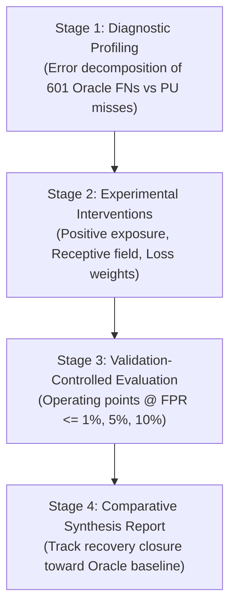

# Antigravity Task Prompt: Investigating and Remediating Low Recovery in Weakly Supervised SMBv1 NIDS

Copy and paste the following prompt into a fresh Antigravity session to initiate the investigation:

---

```markdown
# Antigravity Research Mission: Closing the Gap Between Weakly Supervised PU Learning and Oracle Upper Bound on 165k SMBv1 Dataset

## 1. Dissertation North-Star Objective & Problem Statement

We are researching **IDS-Marked Weak Supervision for Network Intrusion Detection** on SMBv1 / NetBIOS Session Service attacks (`CVE-2008-4834` & `CVE-2008-4835`, MS09-001 underflows across 16 target Snort 3 rules, SIDs 15196–15225).

### The Primary Evaluation Metric:
> **Maximize Snort False Negatives recovered (`is_attack=1 AND alerted=0 AND nn=1`) subject to a controlled benign false-positive budget ($\text{FPR} \le 1\%, 5\%, 10\%$).**

### The Core Problem to Investigate:
We completed a 165,000-record dataset generation across 60 structural archetypes that passed all 6 dissertation quality gates (0.0000% Benign FPR, zero cross-split hash leaks, shallow tree baselines $\le 0.19$ PR-AUC against random baseline 0.091).

However, an acute performance gap exists between our Supervised Oracle upper bound and our Weakly Supervised `nnPU` model on the 29,210 unseen skeleton holdout test set:

| Model / Supervision | Test PR-AUC | FN Recovery @ $\text{FPR} \le 1\%$ | FN Recovery @ $\text{FPR} \le 5\%$ | Overall Attack Recall | Test Precision |
|---|:---:|:---:|:---:|:---:|:---:|
| **Snort 3 Alone (Baseline)** | N/A | 0 / 1,790 (0.00%) | 0 / 1,790 (0.00%) | 35.54% (987 / 2,777) | 100.0% |
| **Weakly Supervised `nnPU`** | **`0.1105`** | **22 / 1,790 (1.23%)** | **92 / 1,790 (5.14%)** | **38.85%** | 12.06% |
| **Supervised Oracle (`is_attack`)** | **`0.5853`** | **601 / 1,790 (33.58%)** | **794 / 1,790 (44.36%)** | **64.13%** | **69.22%** |
| **Supervised Oracle ($T=0.5$)** | 0.5853 | **520 / 1,790 (29.05%)** | N/A (0.29% FPR) | 54.27% | **93.88%** |

The Oracle proves that the byte-level representation contains rich discriminatory signals capable of detecting unseen structural evasion variants. **Your mission is to discover why the weakly supervised `nnPU` model fails to extract this signal, design targeted improvements, and close the recovery gap toward the Oracle baseline.**

---

## 2. Key Technical Resources & Paths

- **Technical Dossier**: Read `ntlm-lab/docs/smb_dataset_and_recovery_investigation_dossier.md` first.
- **Dataset Splits (Skeleton-Holdout)**:
  - Train: `ntlm-lab/shared/datasets/splits/skeleton_holdout/train.json` ($N=105,867$, $\pi_p=0.0888$, $|P|=3,177$, $|U|=102,690$, FNs: 6,220)
  - Val: `ntlm-lab/shared/datasets/splits/skeleton_holdout/val.json` ($N=29,923$, $\pi_p=0.0944$, clean benign: 27,097)
  - Test: `ntlm-lab/shared/datasets/splits/skeleton_holdout/test.json` ($N=29,210$, $\pi_p=0.0951$, clean benign: 26,433, FNs: 1,790)
  - Manifest: `ntlm-lab/shared/datasets/splits/skeleton_holdout/manifest.json`
- **Existing Configs & Predictions**:
  - Oracle: `nids_ml/smb_tcn_2way_oracle_165k.conf` & `artifacts/smb_tcn_2way_oracle_165k/`
  - Weak PU: `nids_ml/smb_tcn_2way_pu_165k.conf` & `artifacts/smb_tcn_2way_pu_165k/`
- **Execution Engine**:
  - Python: `/home/vhorbato/.pyvenv/bin/python`
  - Training Entrypoint: `PYTHONPATH=. /home/vhorbato/.pyvenv/bin/python nids_ml/classifier_creator.py --config <config_path>`

---

## 3. Agentic Division of Labor (Specialist Subagents)

Operate as the **Lead Orchestrator** and delegate specialized diagnostic and experimental work to specialist subagents using `invoke_subagent` (`TypeName: "self"`):

1. **`Role: "Data Analyst"`**:
   - Compare sample predictions between Oracle (`artifacts/smb_tcn_2way_oracle_165k/test_samples.json`) and PU (`artifacts/smb_tcn_2way_pu_165k/test_samples.json`).
   - Profile the 601 FNs that the Oracle recovers but PU misses: are they concentrated in specific structural subcommands (`IOCTL`, `SetSecDesc`, `Open2`, `Secondary`), or do they fail due to parameter word displacements?
   - Inspect buffer length and delimiter positioning to detect any truncation of transaction parameters.

2. **`Role: "Hypertuner"`**:
   - Investigate the **positive exposure bottleneck**: in `TwoWayTrainer.train_pu`, `steps_per_epoch` defaults to `len(loader_p) = 3,177 / 256 = 13` steps. Over 10 epochs, the network sees only 130 batches (~33k out of 102k unlabeled samples).
   - Formulate controlled parameter sweeps:
     a) Positive oversampling / dynamic batching: set `steps_per_epoch = len(loader_u) = 413` so 100% of the unlabeled pool is seen each epoch.
     b) Loss weight balancing: sweep $w_{\text{ssl}} \in [0.0, 0.5, 1.5]$, $w_{\text{alert}} \in [0.1, 0.5, 1.0]$, $w_{\text{pu}} \in [1.0, 2.0]$.
     c) Backbone learning rate scale: test `backbone_lr_scale` $\in [0.1, 0.5, 1.0]$.
     d) Pretraining depth: test 3 vs 5 vs 10 contrastive pretraining epochs.

3. **`Role: "Model Architect"`**:
   - Inspect `nids_ml/models/tcn_2way.py` and `nids_ml/models/blocks.py`.
   - Evaluate receptive field: currently `channels=64, kernel=3, dilations=[1, 2, 4]`. The effective receptive field is only $\sim 15$ bytes! Can a 15-byte receptive field span the distance between the SMB header command (`byte 4`), subcommand function code (`byte 69`), and parameter count underflow (`byte 85`)?
   - Test dilations `[1, 2, 4, 8, 16]` or kernel size `5` to expand receptive field to $> 64$ bytes.
   - Evaluate buffer slicing: check whether expanding `fixed_len` from 192 to 256/384 preserves deeper Trans_Data chunks without diluting representation.

4. **`Role: "Experimenter"`**:
   - Execute dry runs and training runs with resource awareness (GPU acceleration on `cuda`).
   - Manage configuration files, verify parameter counts, export test samples, and maintain artifact reproducibility.

5. **`Role: "Evaluator"`**:
   - Enforce the mandatory dissertation evaluation gates:
     * Operating thresholds ($T_{\text{fpr1\%}}, T_{\text{fpr5\%}}, T_{\text{fpr10\%}}$) must be chosen **strictly on the clean validation benign pool** ($N_{\text{val\_benign}} = 27,097$). Never pick operational thresholds on the test set.
     * Verify PR-AUC monotonic invariance under Platt / Isotonic calibration.
     * Produce the full $is\_attack \times alerted \times nn\_prediction$ error breakdown matrix for every experimental run.

---

## 4. Structured 4-Stage Execution Roadmap



### Stage 1: Diagnostic Profiling & Error Analysis
- Run a targeted analysis comparing Oracle vs PU error distributions across the 15 structural transaction actions, 2 encodings, and 2 ports.
- Calculate exact positive/unlabeled gradient update frequencies in `train_pu`.

### Stage 2: Controlled Experimental Interventions
Test hypotheses systematically using single-variable isolation:
- **Run A (Exposure Correction)**: Decouple `steps_per_epoch` to 414 steps per epoch with positive oversampling.
- **Run B (Receptive Field Expansion)**: Expand TCN dilations to `[1, 2, 4, 8]` to cover full transaction parameter offsets.
- **Run C (Loss Balance & SSL Calibration)**: Adjust $w_{\text{ssl}}$ and $w_{\text{alert}}$ to prevent auxiliary contrastive loss from drowning out weak PU risk signals.
- **Run D (Combined Best Configuration)**: Train for 15 epochs combining validated architectural and training improvements.

### Stage 3: Rigorous Operational Evaluation
- Evaluate each candidate model on the holdout test set ($N=29,210$) at validation operating thresholds ($T_{\text{fpr1\%}}, T_{\text{fpr5\%}}$).
- Compute: Added Benign FPs, Test FPR, Snort FNs Recovered, Recovery Rate, and Overall Attack Detection Recall.

### Stage 4: Synthesis & Reporting
- Compile a comprehensive Markdown report artifact detailing the root cause of the initial low recovery, the impact of each intervention, and the final Snort FN recovery comparison against baseline Snort and the Oracle upper bound.

---

## 5. Inviolable Dissertation Rules & Constraints

1. **Weak Supervision Label Semantics**:
   - `alerted=1` is the noisy teacher signal (Snort alerts).
   - `alerted=0` is unlabeled; **NEVER** treat `alerted=0` as clean benign during training.
   - Ground truth `is_attack` is strictly reserved for evaluation, diagnostics, and Oracle upper bounds. The final operational model must remain weakly supervised (`nnPU`).
2. **Threshold Selection Integrity**:
   - Operational thresholds must be selected **strictly on validation data**. Evaluating thresholds chosen on the test set is an oracle upper bound only.
3. **Primary Evaluation Target**:
   - Optimize for **Snort FN recovery under controlled Benign FPR budgets** ($\le 1\%, \le 5\%$), NOT raw generic F1.
4. **Reproducibility**:
   - Preserve configuration files and predictions in `artifacts/<experiment_name>/`.
```
