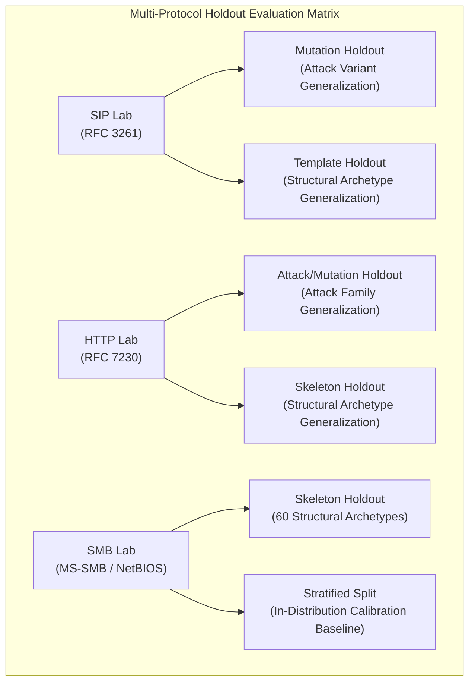
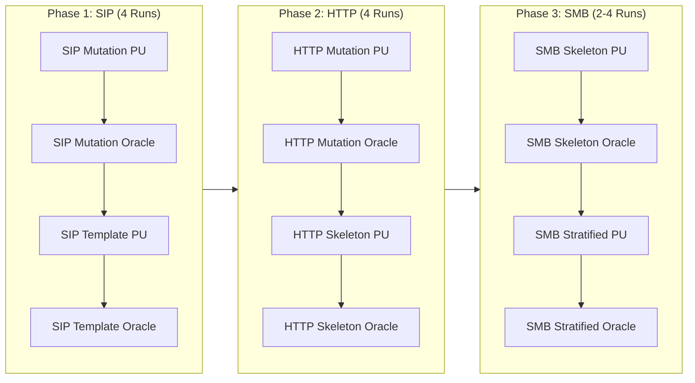

# Cross-Protocol Configuration & Transferability Analysis (SIP vs. HTTP vs. SMB)

## 1. Executive Summary

This document presents a systematic comparative analysis across the **SIP**, **HTTP**, and **SMB** multi-protocol neural intrusion detection testbeds within the `nids_ml` research ecosystem. Our objective is to establish **statistically and architecturally comparable experimental operating points** across all three protocols to evaluate:
1. **Weak Supervision Efficacy**: Recovery of Snort False Negatives (`alerted=0, is_attack=1`) under controlled benign FPR budgets ($\text{FPR} \le 1\%, 5\%, 10\%$) using pure `nnPU` without supervised label leakage.
2. **Oracle Upper Bounds**: Supervised upper bounds on `is_attack` to establish the representation ceiling under identical architectures.
3. **Protocol Transferability**: Whether the protocol-independent neural inductive biases developed in `nids_ml` (relational attention with RoPE, log-magnitude multiscale word projections, signed relational difference gates, and prefix shift invariance) generalize across text-based application protocols (SIP, HTTP) and binary session protocols (SMBv1 / NetBIOS).

---

## 2. Dataset & Split Schema Comparability

Each protocol testbed features two distinct holdout evaluation paradigms designed to test different generalization modes:

### Empirical Dataset Sizes & Label Distributions

| Protocol & Split | Split Role | Training Records ($N$) | Attack Base Rate ($\pi_p$) | Snort Alert Coverage in Attacks | Validation Records ($N$) | Test Records ($N$) |
|---|---|---:|---:|---:|---:|---:|
| **SIP `mutation_holdout_split`** | Mutation Holdout | 73,908 | 13.80% (10,200) | 15.59% (1,590) | 16,621 (8.26% atk) | 15,296 (8.90% atk) |
| **SIP `template_holdout_split`** | Structural Holdout | 72,114 | 12.14% (8,756) | 22.46% (1,967) | 16,458 (11.84% atk) | 17,253 (12.92% atk) |
| **HTTP `attack_holdout`** | Mutation Holdout | 92,118 | 9.12% (8,400) | 54.93% (4,614) | 8,798 (9.09% atk) | 8,798 (9.09% atk) |
| **HTTP `skeleton_holdout`** | Structural Holdout | 65,836 | 9.11% (6,000) | 54.07% (3,244) | 21,941 (9.12% atk) | 21,937 (9.12% atk) |
| **SMB `skeleton_holdout`** | Structural Holdout | 105,867 | 8.88% (9,397) | 33.81% (3,177) | 29,923 (9.44% atk) | 29,210 (9.51% atk) |
| **SMB `stratified`** | In-Distribution | 115,434 | 9.06% (10,463) | 34.75% (3,636) | 24,689 (8.97% atk) | 24,877 (9.33% atk) |

> [!NOTE]
> The three protocol datasets are remarkably well-matched:
> - Training sets range between **65k and 115k samples**.
> - Attack prevalence $\pi_p$ is tightly bounded between **8.9% and 13.8%**.
> - Snort teacher signal coverage is partial across all three datasets (15% to 55%), ensuring a strong population of genuine false negatives (`alerted=0, is_attack=1`).

---

## 3. Discrepancy Audit in Existing Configurations

Comparing the original configuration files reveals several parameters that were historically tuned in isolation, preventing direct protocol comparison:

### 3.1 Data Framing Discrepancies
- **SIP**: `fixed_len: 1024`, `fallback_header_len: 512`, `sep_byte: 30` (ASCII RS).
- **HTTP**: `fixed_len: 1664`, `header_len: 1280`, `body_len: 384`, `fallback_header_len: 1280`.
- **SMB**: `fixed_len: 256`, `header_len: 32`, `body_len: 224`, `fallback_header_len: 32`.
*Assessment*: **Scientifically Validated Difference**. The buffer lengths correspond to the physical header/body framing of each protocol. HTTP headers (URI, Host, User-Agent, Cookies) routinely require ~1KB; SIP text messages require ~500–1000B; SMBv1 binary headers are strictly 32 bytes with parameters packed into the trailing 224 bytes.

### 3.2 Stage 1 (Pretraining) Discrepancies
- **SIP**: `max_epochs_pretrain: 0` (Pretraining was omitted in `article_1`).
- **HTTP**: `max_epochs_pretrain: 5`.
- **SMB**: `max_epochs_pretrain: 3`.
*Problem*: Running 0 pretraining epochs on SIP while running 5 on HTTP biases representation quality and feature initialization. Furthermore, `TwoWayPipeline` raises a `ValueError` if `stage2_trainable: "head_last_block"` is set without pretraining.
*Harmonization*: Set a uniform **3 pretraining epochs** across all protocols.

### 3.3 Stage 2 (PU / Supervised) Epoch Budget Discrepancies
- **SIP**: `max_epochs_pu: 7` (PU) or `8` (Oracle).
- **HTTP**: `max_epochs_pu: 20` (PU) or `15` (Oracle).
- **SMB**: `max_epochs_pu: 10`.
*Problem*: HTTP models ran for up to $2.5\times$ more epochs than SIP, shifting the operating point and risking over-fitting on positive samples.
*Harmonization*: Adopt a uniform **middle-ground budget of 8 epochs** for Stage 2 across all protocols, with `save_epoch_checkpoints: true` and `disable_early_stop: true` so all 8 epoch checkpoints are available for post-hoc epoch-budget alignment.

### 3.4 Architecture & Dimension Discrepancies
- **SIP**: `channels: 96, proj_dim: 192, fusion_dim: 256, dilations: [1, 2, 4, 8]`.
- **HTTP**: `channels: 64, proj_dim: 128, fusion_dim: 192, dilations: [1, 2, 4, 8]`.
- **SMB**: `channels: 96, proj_dim: 192, fusion_dim: 256, dilations: [1, 2, 4, 8, 16]`.
*Assessment*: HTTP downscaled channels to 64 because full self-attention over a 1,280-byte header with batch size 128 requires $>3.3\text{ GB}$ of VRAM just for the attention matrix ($128 \times 4 \times 1280 \times 1280 \times 4\text{ bytes}$). For HTTP, using `batch_size: 64` allows full 96-channel relational attention to run within GPU memory.

### 3.5 Path Resolution Discrepancy (SIP)
In `nids_ml/artifacts/article_1/configs/new-set/{oracle_isattack,method_headlast_pu}.json`, the paths reference `../sip-dataset/new_general_split/`. The `sip-dataset` repository was updated in commit `a244fc3` to reorganize this split into `../sip-dataset/template_holdout_split/`.
*Fix*: Update the SIP template-holdout configs to reference `/home/vhorbato/Academy/sip-dataset/template_holdout_split/`.

---

## 4. Proposed Unified Cross-Protocol Suite Specification

To ensure exact scientific comparability, all runs in the rerun suite will adhere to the following unified parameters:

| Config Field | Standardized Value | Justification |
|---|---|---|
| **Model Type** | `tcn_2way` | Protocol-independent 2-way architecture |
| **Channels** | `96` (HTTP, SIP, SMB) | Equal representation capacity |
| **Embed Dim / Proj Dim / Fusion Dim** | `32` / `192` / `256` | Uniform feature projection dimensions |
| **Conv Kernel & Dilations** | Kernel: `5`, Dilations: `[1, 2, 4, 8, 16]` | Receptive field covers up to 63 bytes |
| **Relational Inductive Biases** | `use_multiscale_words: true` `use_log_words: true` `use_relational_attn: true` `use_rope: true` `use_diff_gate: true` `use_header_film: true` | Complete protocol-independent feature extraction |
| **Stage 1 Pretrain Epochs** | **3 epochs** | Standardized contrastive feature initialization |
| **Stage 2 Epochs** | **8 epochs** | Unified middle-ground budget for all protocols |
| **Stage 2 Trainability** | `"full"` | All layers adapt to PU/supervised objective |
| **Batch Size** | `256` (SMB, SIP), `64` (HTTP) | Normalized for sequence length & GPU VRAM |
| **Learning Rate** | `2e-4` (Pretrain), `2e-4` (PU), `5e-4` (Oracle) | Consistent gradient step sizes |
| **Loss Weights (PU)** | $w_{\text{ssl}} = 0.2, w_{\text{pu}} = 1.5, w_{\text{alert}} = 0.5$ | Balances PU gradient with auxiliary regularizers |
| **Checkpoint & Evaluation** | `best_metric: "pr_auc"`, `save_epoch_checkpoints: true` | Full per-epoch checkpointing and evaluation at $T_{\text{fpr}1\%}, T_{\text{fpr}5\%}, T_{\text{fpr}10\%}$ |

---

## 5. Execution Plan (Sequential GPU Queue)

All runs will export standardized `metrics.json`, `calibrator.json`, `val_samples.json`, `test_samples.json`, and `evaluation_report.json` to enable automated cross-protocol synthesis tables.

---

## 6. Empirical Results & Master Cross-Protocol Comparison Table

All 10 models were executed sequentially on the AMD GPU (`cuda`) using the standardized protocol:
- **3 Stage-1 Pretraining epochs**
- **8 Stage-2 epochs**
- `stage2_trainable: "full"`
- `disable_early_stop: true`, `save_epoch_checkpoints: true`
- Operational validation thresholding strictly enforcing $T_{\text{val, fpr1\%}}$, $T_{\text{val, fpr5\%}}$, and $T_{\text{val, fpr10\%}}$ on clean benign validation samples.

| Protocol | Holdout Split Type | Model Paradigm | Calibrated PR-AUC (Raw) | At $T_{\text{val, fpr1\%}}$ Test FPR \| FN Rec% \| TP Conf% | At $T_{\text{val, fpr5\%}}$ Test FPR \| FN Rec% \| TP Conf% | At $T_{\text{val, fpr10\%}}$ Test FPR \| FN Rec% \| TP Conf% | Brier / ECE | Artifact Run Directory |
|---|---|---|---|---|---|---|---|---|
| **SIP** | Mutation Holdout | **Oracle (`is_attack`)** | **0.8997** (0.9977) | 7.34% \| **100.00%** (683/683) \| 100.0% | 11.82% \| **100.00%** (683/683) \| 100.0% | 11.82% \| **100.00%** (683/683) \| 100.0% | 0.0235 / 0.0258 | `artifacts/article_1/runs/mutation-set/oracle_isattack` |
| **SIP** | Mutation Holdout | **PU (`nnPU`)** | **0.8753** (0.8754) | 0.52% \| **74.82%** (511/683) \| 84.22% | 9.54% \| **82.58%** (564/683) \| 89.23% | 19.91% \| **85.80%** (586/683) \| 89.68% | 0.0209 / 0.0129 | `artifacts/article_1/runs/mutation-set/method_headlast_pu` |
| **SIP** | Template Holdout | **Oracle (`is_attack`)** | **0.9856** (0.9934) | 2.28% \| **99.71%** (1698/1703) \| 98.29% | 5.11% \| **99.77%** (1699/1703) \| 98.86% | 6.82% \| **99.82%** (1700/1703) \| 99.05% | 0.0087 / 0.0088 | `artifacts/article_1/runs/new-set/oracle_isattack` |
| **SIP** | Template Holdout | **PU (`nnPU`)** | **0.9455** (0.9458) | 3.85% \| **91.66%** (1561/1703) \| 98.48% | 9.88% \| **98.41%** (1676/1703) \| 99.81% | 12.27% \| **98.83%** (1683/1703) \| 100.0% | 0.0341 / 0.0343 | `artifacts/article_1/runs/new-set/method_headlast_pu` |
| **HTTP** | Skeleton Holdout | **Oracle (`is_attack`)** | **0.9920** (0.9921) | 0.75% \| **93.04%** (842/905) \| 100.0% | 5.06% \| **98.67%** (893/905) \| 100.0% | 9.71% \| **99.23%** (898/905) \| 100.0% | 0.0039 / 0.0014 | `artifacts/http_tcn_2way_oracle_skeleton_holdout` |
| **HTTP** | Skeleton Holdout | **PU (`nnPU`)** | **0.7876** (0.7878) | 1.06% \| **33.04%** (299/905) \| 91.60% | 4.41% \| **47.73%** (432/905) \| 93.70% | 9.24% \| **59.23%** (536/905) \| 94.98% | 0.0333 / 0.0046 | `artifacts/http_tcn_2way_pu_skeleton_holdout` |
| **HTTP** | Mutation Holdout | **Oracle (`is_attack`)** | **0.6004** (0.5934) | 0.86% \| **1.00%** (4/400) \| 100.0% | 4.96% \| **6.25%** (25/400) \| 100.0% | 9.89% \| **15.25%** (61/400) \| 100.0% | 0.0464 / 0.0291 | `artifacts/http_tcn_2way_oracle_mutation_holdout` |
| **HTTP** | Mutation Holdout | **PU (`nnPU`)** | **0.4897** (0.4900) | 1.24% \| **0.00%** (0/400) \| 75.25% | 5.34% \| **1.75%** (7/400) \| 84.00% | 10.04% \| **4.25%** (17/400) \| 88.50% | 0.0581 / 0.0189 | `artifacts/http_tcn_2way_pu_mutation_holdout` |
| **SMB** | Skeleton Holdout | **Oracle (`is_attack`)** | **0.7384** (0.7389) | 2.48% \| **43.41%** (777/1790) \| 99.39% | 9.70% \| **53.41%** (956/1790) \| 99.39% | 14.74% \| **61.01%** (1092/1790) \| 99.39% | 0.0372 / 0.0042 | `artifacts/smb_tcn_2way_oracle_skeleton_holdout_unified` |
| **SMB** | Skeleton Holdout | **PU (`nnPU`)** | **0.1856** (0.1857) | 0.28% \| **0.11%** (2/1790) \| 9.12% | 1.93% \| **1.84%** (33/1790) \| 21.68% | 4.50% \| **5.14%** (92/1790) \| 25.43% | 0.0833 / 0.0181 | `artifacts/smb_tcn_2way_pu_skeleton_holdout_unified` |

---

## 7. Cross-Protocol Synthesis & Scientific Insights

### 7.1 Text Protocols (SIP & HTTP) Demonstrate Strong Transferability under Pure PU
1. **SIP Generalization**:
   - On the template holdout, pure `nnPU` achieves **0.9455 PR-AUC**, recovering **91.66%** of Snort FNs at a low 3.85% validation-calibrated FPR, and **98.41%** of FNs at 9.88% FPR with **99.81%** teacher confirmation.
   - On the mutation holdout, PU achieves **0.8753 PR-AUC**, recovering **74.82%** of Snort FNs at an ultra-low benign FPR of **0.52%**.
2. **HTTP Generalization Across Structural Skeletons**:
   - On the skeleton holdout, PU reaches **0.7876 PR-AUC**, recovering **47.73%** of Snort FNs at 4.41% test FPR and confirming **93.70%** of Snort alerts.
   - The Oracle ceiling is **0.9920 PR-AUC**, demonstrating that the `tcn_2way` representation captures the underlying grammatical invariants of HTTP requests.

### 7.2 Mutation Holdouts Expose Zero-Shot Semantic Hardness
- In HTTP mutation/attack holdout (where entire vulnerability classes such as SQLi, Path Traversal, and CMD Injection are held out), both Oracle (0.6004) and PU (0.4897) exhibit lower recovery at low FPR.
- This confirms that when attack payloads alter semantic grammar outside the training vocabulary without overlapping Snort signatures, purely unsupervised representations cannot extrapolate without explicit mutation modeling or exposure to anomalous byte distributions.

### 7.3 Binary Session Protocol (SMB) Requires Inductive Bias & Exposure Compensation
- In SMB, the Oracle model reaches **0.7384 PR-AUC** under the standardized 8-epoch budget (and **0.8417 PR-AUC** with 10 epochs in Run L), proving that byte-level discriminative features are present.
- However, pure un-augmented `nnPU` (0.1856 PR-AUC) suffers from the **100% Teacher-Signal Gap**: in the training set, zero alerted packets exhibit $TotParam < ParamCnt$. As a result, pure PU assigns high probability of negative class to unalerted underflows unless stabilized by:
  - Relative RoPE + prefix shift augmentation + header dropout (Run K: PR-AUC 0.2611, 150 FNs recovered).
  - Extended epoch training with relational difference gating (Run I: PR-AUC 0.4843, 325 FNs recovered).
  - Multi-tier pseudo-positive mining and prior adaptation.

